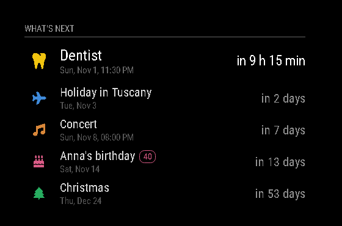
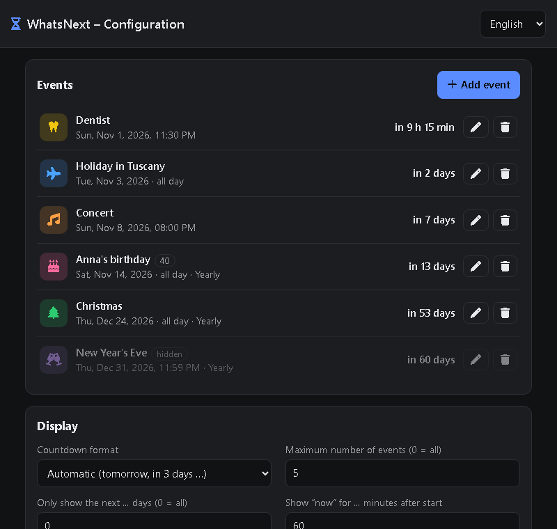

# MMM-WhatsNext

A [MagicMirror²](https://magicmirror.builders/) module that shows upcoming events with a countdown – birthdays, holidays, appointments, anniversaries. Events are managed through a **web interface** (e.g. from your phone), without touching `config.js`.

**Languages:** German, English, French, Italian (mirror and web interface).





## Features

- List of upcoming events with icon, color, date and countdown
- Three countdown formats: automatic (`tomorrow`, `in 3 days`, `in 2 h 15 min`), days only (large number), detailed (`2 d 04:15:09`)
- All-day and timed events; "now" is shown while an event is running
- Repetition: weekly, monthly, yearly (handles 29 February and the 31st of a month)
- Optionally show the number of years (e.g. "Anna turns 40")
- Hide events without deleting them
- Web interface at `http://<mirror>:8080/whatsnext`, changes appear on the mirror immediately
- Optional access protection with a token

## Installation

```bash
cd ~/MagicMirror/modules
git clone https://github.com/ch1ledbe/MMM-WhatsNext
```

The module has no runtime dependencies, so `npm install` is not required.

## Update

```bash
cd ~/MagicMirror/modules/MMM-WhatsNext
git pull
```

Restart MagicMirror afterwards. Saved events in `data/` are kept. See the [CHANGELOG](CHANGELOG.md) for changes.

## Configuration

In `~/MagicMirror/config/config.js`:

```js
{
	module: "MMM-WhatsNext",
	position: "top_left",
	header: "What's next",
	config: {
		maxEvents: 5,
		countdownFormat: "auto",
		apiToken: "my-secret-key" // optional
	}
},
```

| Option | Default | Description |
| --- | --- | --- |
| `maxEvents` | `5` | Maximum number of events shown (`0` = all) |
| `maxDaysAhead` | `0` | Only show events within the next _n_ days (`0` = all) |
| `countdownFormat` | `"auto"` | `"auto"`, `"days"` or `"detailed"` |
| `showDate` | `true` | Show the date below the title |
| `showIcons` | `true` | Show icons |
| `highlightNext` | `true` | Show the next event larger |
| `showSeconds` | `false` | Show seconds in the `"detailed"` format |
| `nowWindowMinutes` | `60` | How long a timed event is shown as "now" after it started |
| `defaultIcon` | `"calendar-day"` | Icon for events without their own icon |
| `apiToken` | `""` | If set, the web interface asks for this key |
| `events` | `[]` | Initial events – only used as long as nothing has been saved through the web interface |

The display options (`maxEvents` to `nowWindowMinutes`) can also be changed in the web interface; values saved there take precedence over `config.js`.

The display language follows MagicMirror's `language` setting. The language of the web interface can be switched in the top right corner.

### Events in config.js (optional)

```js
events: [
	{ title: "Christmas", date: "2026-12-24", repeat: "yearly", icon: "tree", color: "#2ecc71" },
	{ title: "Anna's birthday", date: "1986-11-14", repeat: "yearly", icon: "cake-candles", showYears: true },
	{ title: "Dentist", date: "2026-11-20", time: "14:30", icon: "tooth" }
]
```

Fields: `title`, `date` (`YYYY-MM-DD`), `time` (`HH:MM`, empty = all-day), `repeat` (`none`/`weekly`/`monthly`/`yearly`), `icon` ([Font Awesome](https://fontawesome.com/search?o=r&m=free&s=solid) name), `color` (`#rrggbb`), `showYears`, `enabled`.

## Web interface

Open `http://<mirror-ip>:8080/whatsnext`

To reach the page from other devices, MagicMirror has to listen on the network. In `config.js`:

```js
address: "0.0.0.0",
ipWhitelist: [], // or e.g. ["127.0.0.1", "::ffff:192.168.1.0/24"]
```

Data is stored in `modules/MMM-WhatsNext/data/whatsnext.json` (not overwritten by `git pull`).

**Security:** Without `apiToken`, anyone on the allowed network can change events. The token protects against accidental changes but is not strong protection: like the rest of the MagicMirror configuration, it is delivered to the mirror's browser. Do not expose the web interface to the internet.

The icons of the web interface are loaded from cdnjs; without internet access the page still works, just without icon previews.

## Development

```bash
npm install       # development only (ESLint)
npm run lint      # check code style
npm test          # tests of the date logic
npm run preview   # preview without MagicMirror: http://localhost:8090
```

The preview stores its data in `dev/data/` and does not touch a real installation.

## API

| Method | Path | Description |
| --- | --- | --- |
| `GET` | `/whatsnext/api/meta` | Status, language, whether a token is required |
| `GET` | `/whatsnext/api/state` | Events and settings |
| `POST` | `/whatsnext/api/events` | Create an event |
| `PUT` | `/whatsnext/api/events/:id` | Replace an event |
| `DELETE` | `/whatsnext/api/events/:id` | Delete an event |
| `PUT` | `/whatsnext/api/settings` | Save display settings |

If `apiToken` is set, the header `X-WhatsNext-Token` must be sent.

## License

[MIT](LICENSE)
